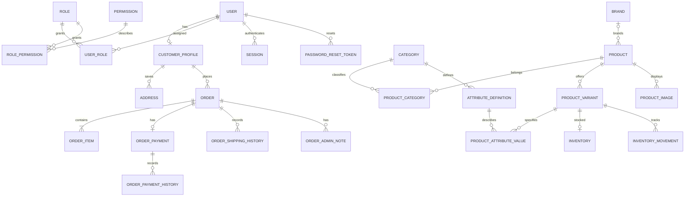

# Data Model

- **Purpose:** Describe the implemented relational model and its current boundaries.
- **Audience:** Developers, reviewers, and data operators.
- **Last updated:** 2026-11-24
- **Related docs:** [System overview](system-overview.md), [Glossary](../00-overview/glossary.md), [Store API](../api/store-api.md)

## Implemented tables

The initial migration contains 19 InnoDB tables. The current Drizzle schema adds six order-management tables (25 tables total); the new order migration is generated separately. Both migrations have been applied and verified on fresh disposable MariaDB 11.4 and 10.6 databases.

| Area                    | Tables                                                                                                            | Responsibility                                                                                                    |
| ----------------------- | ----------------------------------------------------------------------------------------------------------------- | ----------------------------------------------------------------------------------------------------------------- |
| Identity and access     | `users`, `customer_profiles`, `roles`, `permissions`, `user_roles`, `role_permissions`                            | Customer identity, profile, and server-checked role/permission assignments.                                       |
| Authentication          | `sessions`, `password_reset_tokens`                                                                               | Hashed session-token fingerprints and reset-token storage. Reset delivery and redemption are not yet implemented. |
| Addresses               | `addresses`                                                                                                       | Saved customer delivery addresses.                                                                                |
| Catalog                 | `categories`, `brands`, `products`, `product_categories`, `product_variants`, `product_images`                    | Bilingual catalog records, categorization, SKUs, and image metadata. No product records are seeded.               |
| Flexible specifications | `attribute_definitions`, `product_attribute_values`                                                               | Category-scoped text, number, boolean, and select attributes associated with product variants.                    |
| Inventory               | `inventory`, `inventory_movements`                                                                                | On-hand/reserved quantities and an auditable movement ledger.                                                     |
| Orders                  | `orders`, `order_items`, `order_payments`, `order_shipping_history`, `order_payment_history`, `order_admin_notes` | Customer/order snapshots, manual payment and shipping updates, and administrator audit records.                   |

ER relationships:

## Implemented order-management schema

The new Drizzle schema and generated migration define:

- `orders`: customer ownership plus immutable contact/address snapshots, EGP subtotal/shipping-fee/total minor units, and manually managed shipping details and status.
- `order_items`: product-name, SKU, requested quantity, and unit/line-price snapshots. Catalog deletions do not erase order lines.
- `order_payments`: one manual payment record per order for COD, wallet, or InstaPay, with verification actor and timestamp.
- `order_shipping_history`: status, fee, and shipping-method before/after values, notes, actor, and timestamp.
- `order_payment_history`: payment status and customer-reference before/after values, notes, actor, and timestamp.
- `order_admin_notes`: internal notes linked to the author.

The admin UI can list, inspect, and update existing order records with server-side permission checks. Checkout, cart persistence, order creation, customer order history, payment instructions, notification delivery, and customer-facing order status are not implemented. With no order-creation workflow, a newly configured dashboard will remain empty until orders exist in the database.

The order migration is not applied to production. Auth, catalog, product-detail, and order-query paths have been exercised against disposable local MariaDB databases, but the GoDaddy database and its grants/version remain unverified.

## Other planned commerce tables

Carts and cart items (including guest-cart preservation), coupons, wishlists, and editable store/content settings remain unimplemented.

Quote requests are not part of the current or planned migration. Do not add a quote/lead table, migration, or other persistence for submissions until the owner approves the delivery, storage, privacy, and retention decision in [ADR-0005](../decisions/ADR-0005-quote-request-delivery-persistence.md).

### Conceptual quote-management model (approved requirements; not implemented)

The approved quote workflow requires, when implemented, persistence for quote records and clear separation from Sales Orders:

- Quote header: unique reference number, customer/contact information, submission timestamp, status, assigned employee, and internal administration notes.
- Quote line items: product and variant/SKU reference, requested quantity, displayed price captured at submission, confirmed price set by administration, and agreed quantity/price when negotiation concludes.
- Communication history: channel (phone call, WhatsApp, or email), communication date, assigned employee, outcome, and internal notes.
- Price history: each confirmed-price change and review decision must remain traceable without overwriting the submitted displayed-price snapshot.
- Quote status history: New, Under Review, Waiting for Customer, Approved, Rejected, and Archived, including status-change metadata.
- Sales Order link: an optional traceable one-to-one conversion result from an approved quote. Duplicate conversion must be prevented.

The quote line item must preserve historical prices independently from the current product catalog price. Displayed prices are snapshots in EGP minor units; confirmed prices are also integer EGP minor units and must support a separate value for every product in the request. Decimal or floating-point currency arithmetic is prohibited.

When quote persistence is eventually approved, employee roles and customer data access controls require explicit implementation decisions. The public quote UI must not expose internal notes, communication history, confirmed prices, employee assignments, or Sales Order records. Quote submission must never create a Sales Order automatically.

## Phase 2 mock-only implementation boundary

The admin quote prototype is not backed by this data model. It reads an isolated static fixture module and keeps temporary interactions in React component state. It creates no quote tables, migrations, records, status history, communication records, notes, or Sales Order references.

## Persistence rules

- Use InnoDB, explicit foreign keys/indexes, and migration-managed schema changes. The initial migration explicitly sets InnoDB and `utf8mb4`; Drizzle does not generate those table options, so preserve them when adding migration-created tables.
- Tables use UUID strings for IDs. Creation/update timestamps use portable `CURRENT_TIMESTAMP` defaults.
- Product prices are nullable unsigned integer EGP minor units and default to `EGP`; floating-point currency calculations are not allowed.
- Product attributes are category-scoped, typed definitions; numeric values use decimal storage rather than floating-point money.
- Customer-facing catalog queries show only published products with a configured price. The development seed adds approved categories and authorization roles/permissions only, not products, stock, real prices, or an administrator account.
- Customers may access only their own profile, addresses, carts, and orders. Admin operations require a server-side role/permission check.
- Order-time product details and prices are preserved as snapshots. Shipping changes require `shipping.manage`; payment verification requires `payments.verify`; order reads and internal notes require `orders.manage`.
- Electronic-wallet and InstaPay orders may be marked paid only by a user with `payments.verify` who supplies verification notes. COD is marked paid only after the order is delivered.

## Migration and database status

The initial migration and separate order migration are generated and verified through repeat application on fresh MariaDB 11.4 and 10.6 compatibility databases. The GoDaddy database hostname, user grants, engine/version, connectivity, quotas, and connection limits still require verification in the actual hosting account. Never run migrations against production until those checks and a verified backup are complete.
