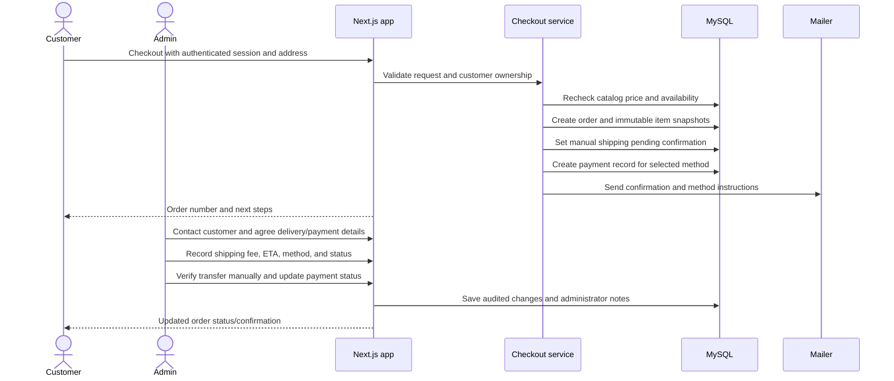
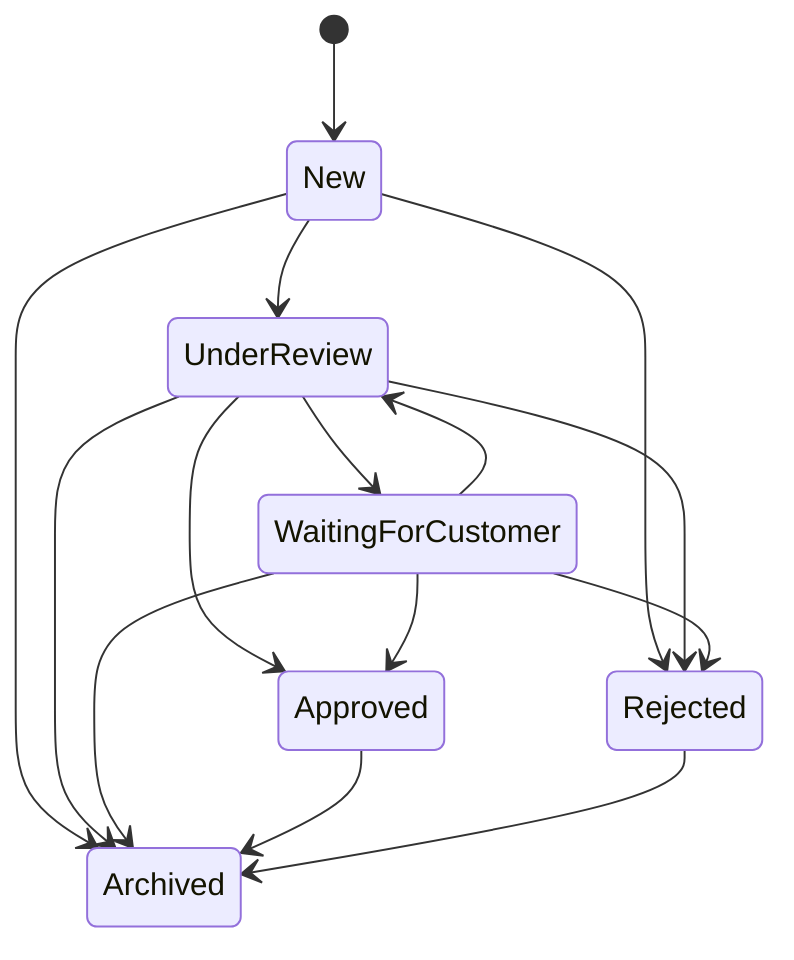

# Request Flows

- **Purpose:** Document important customer and staff interactions before service implementation.
- **Audience:** Developers, reviewers, and AI agents.
- **Last updated:** 2026-11-24
- **Related docs:** [Data model](data-model.md), [Store API](../api/store-api.md), [Security](../engineering/security.md), [ADR-0005: Quote request delivery and persistence](../decisions/ADR-0005-quote-request-delivery-persistence.md)

## Registration and guest-cart merge

```mermaid
sequenceDiagram
  actor Customer
  participant Browser
  participant App as Next.js app
  participant Auth as Auth service
  participant Cart as Cart service
  participant DB as MySQL

  Customer->>Browser: Browse and add products as guest
  Browser->>App: Add item with temporary cart token
  App->>Cart: Validate item and update guest cart
  Cart->>DB: Save guest cart
  Customer->>Browser: Register or log in before checkout
  Browser->>App: Submit credentials and guest cart token
  App->>Auth: Validate credentials and create session
  Auth->>DB: Verify/create user and rotate session
  App->>Cart: Merge guest cart into customer cart
  Cart->>DB: Revalidate items and quantities; persist customer cart
  App-->>Browser: Set secure session cookie and return merged cart
```

## Manual checkout and payment

The sequence below describes the approved target flow; checkout, customer order creation, and notification delivery are not implemented. The current admin order pages can manage records only after they have been created by a future authorized checkout/order service or in an explicitly disposable test database.



## Quote request and quote management (approved workflow; implementation not started)

Quote requests are independent of carts, checkout, and orders. The current UI is a localized unavailable page only; it has no form, entry point, or submission handler. A future form may allow guest submission. If a customer is already signed in, the browser may prefill editable name and email fields; a request will not be linked to the account, cart, or order.

The localized unavailable-page routes are `/en/quote` and `/ar/quote`; they are `noindex`. Bare `/quote` redirects to `/en/quote` using the existing default-locale mechanism from the storefront root. The redirect preserves only a valid `sku` (1–120 ASCII letters, digits, `.`, `_`, or `-`) and a known `category` slug. Internal entry points are not present; add a locale-aware link helper when they are authorized.

```mermaid
sequenceDiagram
  actor Visitor
  participant Browser
  participant App as Next.js app
  participant Guard as Request validation and limits
  participant Notifier as LeadNotifier
  participant Log as Development metadata logger

  Visitor->>Browser: Open /{locale}/quote with optional valid sku/category
  Browser->>App: POST /api/quote with locale in JSON body
  App->>Guard: Check origin, body size, honeypot, Zod schema, and rate limits
  alt Invalid or honeypot populated
    Guard-->>App: Reject without echoing submitted values
    App-->>Browser: 400 generic error; no success state
  else Rate limit exceeded
    Guard-->>App: Reject request
    App-->>Browser: 429 retry message; no success state
  else Feature flag is disabled
    App-->>Browser: 503 unavailable; no success state
  else Valid request and feature enabled
    App->>Notifier: Submit validated lead
    alt Notifier confirms delivery or persistence
      Notifier-->>App: delivered
      App-->>Browser: 201 success; reference only if persisted
    else Not configured (default or DevMetadataNotifier)
      Notifier-->>App: not_configured
      App-->>Browser: 503 unavailable; no success state
    else Failed or thrown error
      Notifier-->>App: failed
      App-->>Browser: 500/502 retry message; no success state
    else Delivery outcome unknown or timed out
      Notifier-->>App: timeout/unknown
      App-->>Browser: 504 unconfirmed message; no success state
    end
  end
  Note over Log: Development-only metadata: submission ID, timestamp, locale, field names, value lengths; never values
```

### Quote request invariants

- The page and redirect are implemented as UI-only. The API route, form, feature flag, notifiers, and delivery workflow are not implemented.
- The unavailable state is always shown; no quote entry points or success state are present. `QUOTE_DELIVERY_ENABLED` is planned but not implemented and must default to `false` if later added.
- Validate the API body's `locale` against supported locales. Only non-personal `sku` and `category` query parameters may prefill the form; validate their length/characters and category membership, silently ignore invalid values, and never echo them. Submit all personal data by POST.
- For a future form, required fields are full name, email, message, and unchecked consent. Optional fields are company, phone, product/SKU, category, and quantity. The owner confirmed `email_required`; exact form field limits remain unresolved.
- Never persist request data in a database, file, browser storage, cookie, cache, or queue under the current approval. Keep it in browser memory for retry after failure; clear after confirmed success.
- A success response/UI is allowed only after confirmed delivery or persistence. Never show a reference unless persistence returned one.
- Do not log request bodies or submitted values. `DevMetadataNotifier` runs only in development, logs only the approved metadata, always returns `not_configured`, and therefore maps to 503 with no success UI.
- Test successful UI only with a `FakeDeliveredNotifier` under the tests tree; prohibit importing it or any delivered notifier into production code.
- Rate-limit per IP and email and use an idempotency key, but do not choose a storage/key strategy until its privacy and shared-hosting behavior are approved.
- Delivery method, official recipient email, retention, response-time promise, privacy/consent wording, CAPTCHA provider/configuration, input limits, rate limiting, idempotency, employee/administrator permissions, and customer data access controls are unresolved. The `/quote` redirect is covered by E2E tests with and without valid prefill parameters.

### Approved customer and administration workflow

1. The customer browses public product catalog records and views website prices.
2. The customer selects multiple products and submits a quantity for every selected product.
3. The customer provides contact information and submits the quote request.
4. Submission creates or queues a quote for internal review only; it does not create an order or payment obligation.
5. An administrator sees the request in the dashboard under a review status.
6. The administrator verifies availability, requested quantities, SKUs, and the price displayed at submission.
7. The administrator records a separate confirmed price for each requested product. Catalog-price changes must not alter any historical quote price.
8. An assigned employee contacts the customer through phone call, WhatsApp, or email.
9. The employee records communication date, channel, outcome, assigned employee, and internal notes.
10. Customer approval causes an explicit conversion action that creates one Sales Order using agreed quantities and confirmed prices. The Quote Reference Number remains traceable on the converted order.
11. Customer decline or closure changes the quote to rejected or archived status. No Sales Order is created.

### Conceptual quote dashboard

The future dashboard must include All Requests, New Requests, Under Review, Waiting for Customer, Approved, Rejected, and Archived views. A quote record must expose customer information, requested products and quantities, SKU, displayed price snapshot, confirmed price per product, submission date, status, internal notes, communication history, and assigned employee.

The quote and Sales Order remain independent records. Automatic conversion is prohibited. The conversion boundary must enforce exactly one Sales Order per approved quote and must preserve the original quote reference. This requirement is documentation-only until the data model and dashboard are implemented.

### Safe planning and mock-prototype boundary

Only the following quote work is safe before unresolved decisions are approved:

- Dashboard information architecture and navigation.
- Static or clearly marked mock quote-list/detail/pricing/communication screens.
- English and Arabic copy specifications, RTL/LTR behavior, and accessibility rules.
- Status lifecycle and transition specifications.
- Proposed reusable component structure.
- Proposed permission matrix and proposed API contracts.

No implementation may add a quote table, migration, persistence service, public submission route, active form, delivery integration, CAPTCHA, rate-limit store, idempotency store, or Sales Order conversion behavior.

Mock quote data must be explicitly labeled as sample data and must never connect to customer identity, real inventory, real prices, or production actions.

### Proposed quote lifecycle



`Under Review` may add or revise confirmed prices, availability notes, internal notes, and communication records. `Waiting for Customer` means the team is awaiting an explicit customer decision. `Approved` means explicit customer acceptance has been recorded. `Approved` may proceed to a separately authorized Sales Order conversion. Rejected and Archived are terminal for normal negotiation but retain historical records.

No transition may occur through a public customer action unless future security and permission decisions explicitly approve it.

### Proposed permission matrix (awaiting approval)

| Capability                              | Customer                           | Employee                              | Quote administrator                   | Sales administrator |
| --------------------------------------- | ---------------------------------- | ------------------------------------- | ------------------------------------- | ------------------- |
| Submit quote request                    | Pending approval                   | No proposal                           | No proposal                           | No proposal         |
| Read an assigned quote                  | Own records only, pending approval | Proposed                              | Proposed                              | Read-only proposal  |
| Read all quote records                  | No                                 | No proposal                           | Proposed                              | Read-only proposal  |
| Assign employee                         | No                                 | No                                    | Proposed                              | No proposal         |
| Edit internal notes                     | No                                 | Proposed for assigned records         | Proposed                              | No proposal         |
| Review availability and displayed price | No                                 | Proposed                              | Proposed                              | Read-only proposal  |
| Set confirmed prices                    | No                                 | No proposal                           | Proposed                              | No proposal         |
| Record communication                    | No                                 | Proposed for assigned records         | Proposed                              | No proposal         |
| Change quote status                     | No                                 | Proposed for assigned workflow stages | Proposed                              | No proposal         |
| Approve customer acceptance             | No                                 | No proposal                           | Proposed only after approved workflow | No proposal         |
| Convert to Sales Order                  | No                                 | No                                    | Proposed                              | Proposed            |

This matrix is a proposal, not an implementation or approval of permissions. Employee and administrator roles, scopes, delegated access, audit, and least-privilege controls remain unresolved.

### Proposed API contracts (non-implemented)

| Method and path                                   | Proposed authorization                   | Purpose                                                   | Status                             |
| ------------------------------------------------- | ---------------------------------------- | --------------------------------------------------------- | ---------------------------------- |
| `POST /api/quote`                                 | Public, currently blocked                | Create a multi-product quote with trusted price snapshots | Proposal; must remain inactive     |
| `GET /api/admin/quotes`                           | Quote administrator                      | List/filter/sort/paginate quote requests                  | Proposal; endpoint not implemented |
| `GET /api/admin/quotes/[quoteId]`                 | Quote read permission                    | Retrieve quote details, line items, histories             | Proposal; endpoint not implemented |
| `PATCH /api/admin/quotes/[quoteId]/status`        | Assigned employee or quote administrator | Apply an approved status transition                       | Proposal; endpoint not implemented |
| `PATCH /api/admin/quotes/[quoteId]/assignment`    | Quote administrator                      | Assign an employee                                        | Proposal; endpoint not implemented |
| `PUT /api/admin/quotes/[quoteId]/prices`          | Quote administrator                      | Update confirmed line prices with history                 | Proposal; endpoint not implemented |
| `POST /api/admin/quotes/[quoteId]/communications` | Assigned employee or quote administrator | Record an external communication manually                 | Proposal; endpoint not implemented |
| `POST /api/admin/quotes/[quoteId]/notes`          | Assigned employee or quote administrator | Add an internal administrative note                       | Proposal; endpoint not implemented |
| `POST /api/admin/quotes/[quoteId]/convert`        | Quote/Sales administrator                | Explicitly convert an approved quote                      | Proposal; endpoint not implemented |

Before implementation, each contract requires Zod validation, authorization, standard error envelopes, audit behavior, pagination, and security/privacy decisions.

### Phase 2 mock admin prototype

The implemented prototype routes are locale-prefixed:

- `/[locale]/admin/quotes` for the overview and quote list.
- `/[locale]/admin/quotes/[reference]` for quote details, pricing, status, communication, notes, and conversion preview.

The prototype is protected with the existing `admin` role guard. It does not introduce quote permissions or weaken public/customer route protection. Mock data is isolated from application services and UI state.

The list supports search, status/date filtering, sorting, and pagination against static fixtures. The details page supports local confirmed-price editing, displayed-versus-confirmed totals, documented status transitions, temporary notes, and a disabled conversion preview. Refreshing or leaving the page discards temporary changes.

The prototype does not persist customer data, send messages, call APIs, create Sales Orders, or imply that a status or price change was saved.

## Authorization invariants

- Checkout rejects unauthenticated requests, regardless of UI state.
- Every order is linked to the authenticated customer ID from the server session, never a client-supplied owner ID.
- Customer-supplied payment references are stored as unverified. Only authorized administrators can mark a transfer as paid.
- Only authorized administrators can change manual shipping charges, payment state, inventory, and order status.
