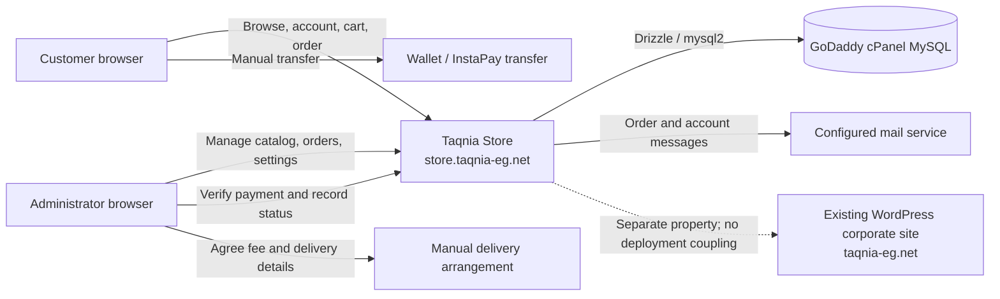
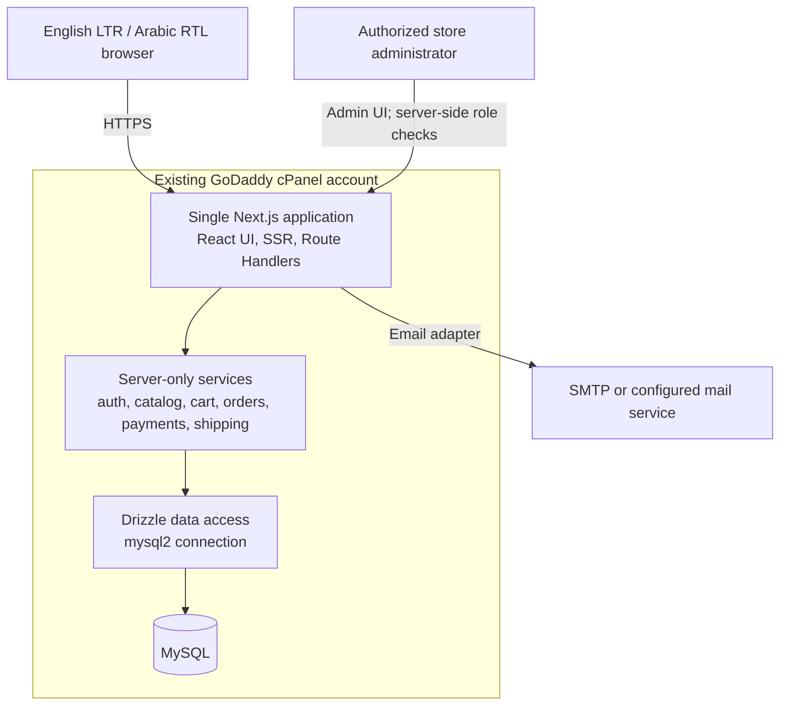

# System Overview

- **Purpose:** Show the Taqnia Store system boundary and runtime components.
- **Audience:** Taqnia owners, developers, and operations staff.
- **Last updated:** 2026-11-24
- **Related docs:** [Project brief](../00-overview/project-brief.md), [Hosting and deployment](hosting-and-deployment.md), [Data model](data-model.md)

## Context

## Containers

## Boundaries

- This repository contains only the store. The corporate WordPress site is an external system, not a second app or a shared codebase.
- The store is intended to be the only Node.js app in the cPanel account's single application slot.
- MySQL is accessed only from server-only code. Browser code never receives DB credentials.
- Payment and shipping operations use interfaces so manual workflows can later be supplemented with provider adapters.
- Analytics are disabled in version 1. Future analytics must be behind one configuration flag and wrapper.
- Deployment compatibility depends on account-specific checks listed in [hosting and deployment](hosting-and-deployment.md).

## Implementation status

The current implementation includes the storefront, catalog/auth foundations, a protected bilingual product-management UI, and a protected order-management UI for existing order records. The order schema's separate generated migration is verified on fresh disposable MariaDB 11.4 and 10.6 databases but has not been applied to production. Cart and checkout, order creation, customer order history, payment and shipping notifications, and provider integrations remain unimplemented; their appearance in the target architecture is not evidence that they are operational.
