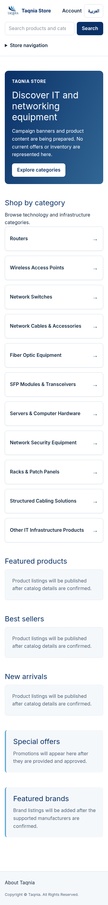
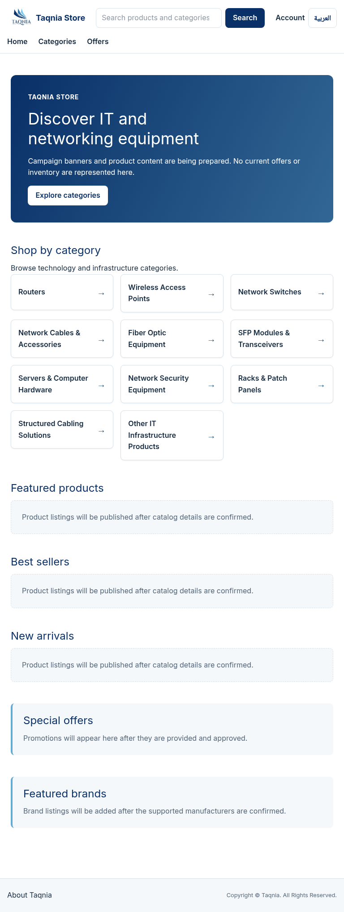
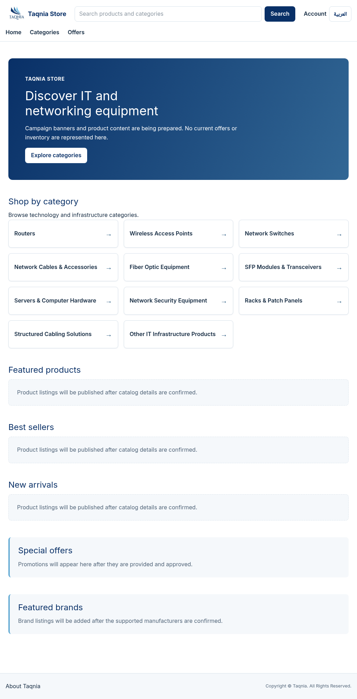
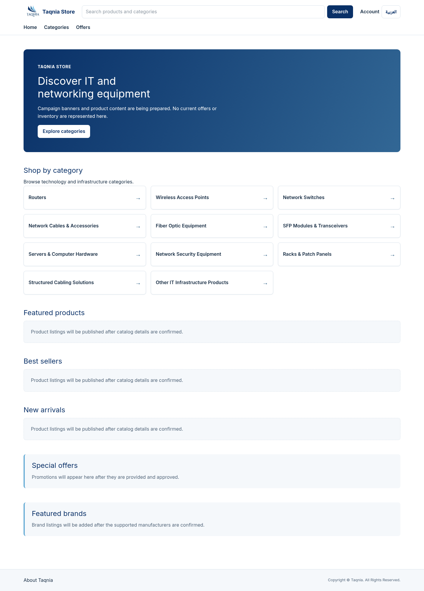
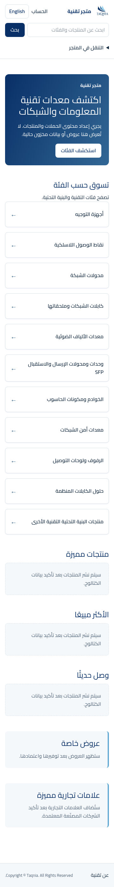
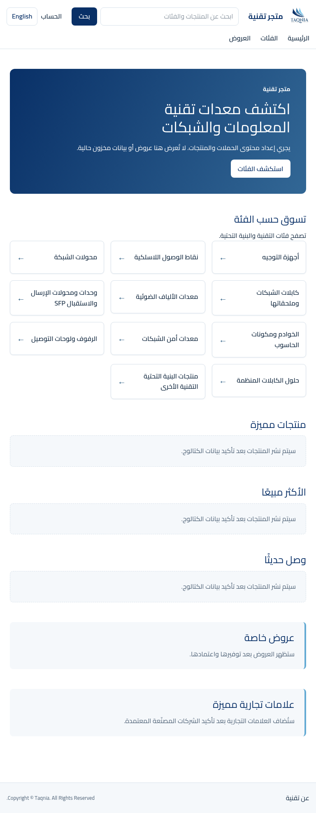
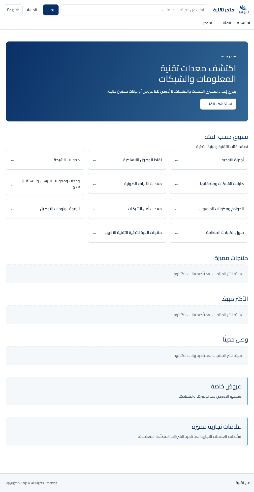
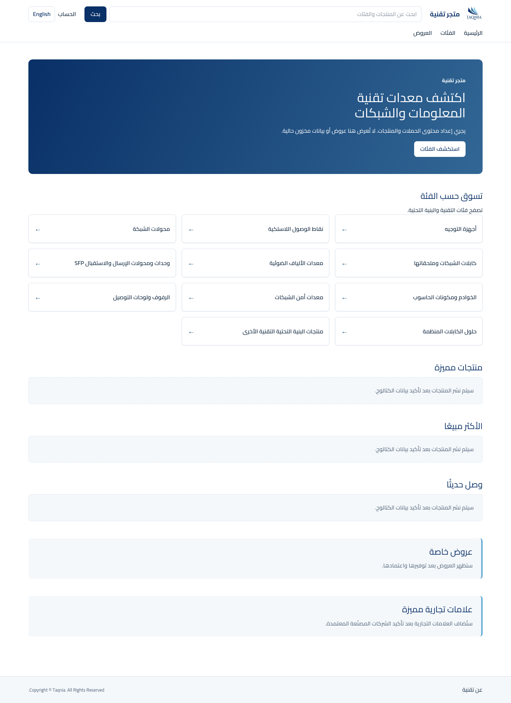

# Taqnia Store Home Page UX Audit

- **Purpose:** Record the current storefront baseline before proposed UX changes.
- **Audience:** Store owner, product/design, frontend, accessibility, and QA.
- **Audit date:** 2026-11-24
- **Scope:** English and Arabic home pages only, at 360, 768, 1024, and 1440 CSS pixels.
- **Status:** Phase 1 audit; no storefront code or UI was changed.
- **Related docs:** [Design system](design-system.md), [Accessibility](accessibility.md), [Content guidelines](content-guidelines.md)

## Summary

The current home page is functional as a bilingual product-category entry point, but it reads as an unfinished shell rather than a store. The highest-impact problems are internal-facing placeholder copy, three repeated empty product sections, no cart or quote/contact path, text-only categories with an unbalanced final desktop row, and a nearly empty footer. English axe scanning also finds one serious accessible-name mismatch on the store-brand link.

The audited build is responsive without horizontal overflow at the four tested widths. Arabic page direction is set correctly. Text color tokens measured for this audit pass WCAG AA contrast thresholds; the muted text can still feel visually weak because of its small size and the low-density page hierarchy.

## Audit method and environment

- Built the current app with `npm run build` and audited the production server locally; no real store, database, or external business data was used.
- Lighthouse CLI 13.6.0 with Chromium 155.0.8059.84. Mobile reports use Lighthouse mobile emulation; desktop reports use the desktop preset. These are local lab results, not production field measurements.
- axe-core 4.14.1 ran against the home page in English and Arabic at all four widths (eight scans total).
- Browser layout measurements checked `document.documentElement.scrollWidth`, category grid columns, rendered empty states, and section headings.
- Full-page screenshots were captured at device scale factor 1. Screenshot width matches the requested CSS viewport; page height varies with localized text and wrapping.
- Lighthouse lab reports do not provide real-user INP. Total Blocking Time is shown as a lab diagnostic and must not be presented as INP.

## Baseline measurements

### Lighthouse

| Locale  | Viewport | Performance | Accessibility | Best practices | SEO |   FCP |   LCP |    TBT |   CLS |
| ------- | -------- | ----------: | ------------: | -------------: | --: | ----: | ----: | -----: | ----: |
| English | Mobile   |          86 |           100 |            100 |  92 | 1.1 s | 1.1 s | 570 ms | 0.000 |
| English | Desktop  |          99 |           100 |            100 |  92 | 0.3 s | 0.3 s | 100 ms | 0.000 |
| Arabic  | Mobile   |          97 |           100 |            100 |  92 | 1.0 s | 1.0 s | 190 ms | 0.004 |
| Arabic  | Desktop  |         100 |           100 |            100 |  92 | 0.3 s | 0.3 s |  60 ms | 0.005 |

The English mobile performance result is below the requested 90-point target. Lighthouse identifies JavaScript execution/blocking, render-blocking requests, and image-delivery opportunities among the mobile findings. All measured LCP values are below 2.5 s and CLS values below 0.1 in this local lab run. The SEO score is 92 because `/robots.txt` currently resolves through the locale route/redirect instead of returning a valid robots file.

Lighthouse reports accessibility 100, but the separate axe scans find a serious issue: the English brand link has visible text “Taqnia Store” while its explicit accessible name is “Home.” Axe reported this same node at all four English widths; the Arabic scans reported no violations.

### axe-core and layout

| Check                                  | Result                                                                                                        |
| -------------------------------------- | ------------------------------------------------------------------------------------------------------------- |
| English axe scans                      | 1 serious rule/node: `label-content-name-mismatch` on `.store-brand`, repeated at 360, 768, 1024, and 1440px. |
| Arabic axe scans                       | 0 violations at the four tested widths.                                                                       |
| Horizontal overflow                    | None observed; document width equals viewport width at all eight locale/viewport combinations.                |
| Category grid at 360px                 | 1 column.                                                                                                     |
| Category grid at 768, 1024, and 1440px | 3 columns; with 11 categories, the final row contains two cards and leaves one empty grid position.           |
| Repeated empty product states          | 3 on each locale’s home page (Featured products, Best sellers, New arrivals).                                 |

### Home route JavaScript

On a clean production-page navigation, the browser requested 7 JavaScript resources:

- **Encoded resource body total:** 145,963 bytes (142.5 KiB).
- **Decoded resource body total:** 486,063 bytes (474.7 KiB).
- **Transfer total reported by the browser:** 148,063 bytes (144.6 KiB).

This is the aggregate of script resources requested on the home route in the audited browser session, including shared framework/runtime chunks; it is not the size of one JavaScript file. It is a useful before baseline for a like-for-like after measurement.

### Contrast spot checks

Ratios were calculated from the current CSS token values using the WCAG relative-luminance formula:

| Foreground / background                     | Contrast | Result                              |
| ------------------------------------------- | -------: | ----------------------------------- |
| Muted `#526579` on subtle surface `#f5f8fb` |   5.64:1 | Passes 4.5:1 normal-text threshold. |
| Body `#152b42` on white `#ffffff`           |  14.42:1 | Passes.                             |
| White on brand navy `#093067`               |  12.88:1 | Passes.                             |
| White on brand blue `#326795`               |   5.98:1 | Passes.                             |

No contrast-token failure was found in these representative combinations. The perceived weakness comes from the small muted helper copy and overall hierarchy/density; validate any later token changes against WCAG AA instead of darkening colors without measurement.

## Heuristic and interface review

Severity reflects effect on discovering or buying products, not a claim that an unimplemented capability is already part of the production service.

### Nielsen heuristics

| Heuristic / finding                                                                                                                                                                                     | Severity | Proposed fix                                                                                                                                  |
| ------------------------------------------------------------------------------------------------------------------------------------------------------------------------------------------------------- | -------- | --------------------------------------------------------------------------------------------------------------------------------------------- |
| Visibility of system status: there is no cart entry/count, stock/availability state, or quote progress/status in the header or home page.                                                               | High     | Add a clear cart entry point and count only when backed by actual cart state; do not imply stock availability without verified inventory.     |
| Match between system and real world: hero text says campaign and product content are being prepared and that no offers/inventory are represented. This is internal project status, not customer value.  | High     | Replace it with owner-approved customer-facing value copy; label any unapproved interim copy in the content layer and launch checklist.       |
| User control and freedom: locale switching preserves the current route, and the mobile navigation uses a native disclosure. Search has no clear action, suggestion dismissal, or recent-query controls. | Medium   | Preserve the working locale behavior; add clear/dismiss behavior only with an accessible search interaction design.                           |
| Consistency and standards: category links are consistent but text-only; the mobile disclosure is not a category menu or a replacement for full category discovery.                                      | Medium   | Establish one reusable category-card and navigation pattern with consistent icon, description, focus, and active states.                      |
| Error prevention: the current search gives no category scope, SKU guidance, or technical filters. A buyer may not know whether a SKU query is supported.                                                | Medium   | Make the supported search scope clear and add SKU/spec search only when catalog/search data supports it.                                      |
| Recognition rather than recall: 11 category names are the only cues; there are no short descriptors, icons, or visible product compatibility/specification cues.                                        | Medium   | Use consistent, non-product-specific category illustrations and approved short descriptors; expose technical details only from verified data. |
| Flexibility and efficiency: the home page has no quote action, product filters, or quick path for a buyer who already knows a SKU.                                                                      | High     | Add an owner-approved quote path and improve discovery around verified product identifiers; keep the path usable on mobile and keyboard.      |
| Aesthetic and minimalist design: three consecutive empty product sections repeat the same sentence, followed by offers and brands sections that are also just explanatory placeholders.                 | High     | Omit sections without content and render one intentional catalog-empty state with a useful next action.                                       |
| Help users recognize, diagnose, and recover: no store support/contact path is visible if a buyer cannot find an item.                                                                                   | High     | Provide a support/quote route from approved contact or form configuration; do not invent telephone, email, or messaging details.              |
| Help and documentation: the footer contains only an external “About Taqnia” link and copyright, so shopping policies and store help are not discoverable.                                               | High     | Add approved customer-service and legal links; clearly mark drafts and keep production launch blocked until policies are approved.            |

### Visual hierarchy, spacing, responsiveness, and RTL

| Finding                                                                                                                                                                                                                                                 | Severity | Proposed fix                                                                                                                                                                                                           |
| ------------------------------------------------------------------------------------------------------------------------------------------------------------------------------------------------------------------------------------------------------- | -------- | ---------------------------------------------------------------------------------------------------------------------------------------------------------------------------------------------------------------------- |
| The hero has a strong navy gradient and readable heading, but the text occupies one side and the rest of the panel is visually unused. The body copy exposes internal preparation status.                                                               | High     | Use a customer-focused, approved heading and CTA hierarchy. Use a reserved campaign slot only when approved content exists, otherwise a lightweight abstract infrastructure illustration with no fake product imagery. |
| Repeated full-width empty sections make the page long (1,976–2,001px at 1024/1440px, 1,972–2,029px at 768px, and 2,785–2,980px at 360px) without adding buying information.                                                                             | High     | Consolidate the empty catalog to one purposeful block and do not render empty product, offer, or brand sections.                                                                                                       |
| Section headings are 24px/600-ish via browser defaults/tokens and are readable, but the page has little contrast between category browsing and empty merchandising content. Muted helper text is small (14px) even though its measured contrast passes. | Medium   | Strengthen the type hierarchy and section surfaces using the existing token system; reserve muted small text for secondary details.                                                                                    |
| At 360px, the page has one category column and wraps into a long list. At 768px and wider the three-column grid leaves one of the 11-category cells empty in its final row.                                                                             | Medium   | Set a deliberate responsive category layout (including an intentional 11-item desktop ending) and verify at intermediate widths.                                                                                       |
| No horizontal overflow was measured at the four audited widths. The header compresses to brand/actions plus a second-row search and native mobile navigation.                                                                                           | Low      | Preserve the no-overflow behavior; keep touch targets and search/action spacing comfortable at 360–390px.                                                                                                              |
| English/LTR and Arabic/RTL render with correct document `lang`/`dir`; the directional category arrow is mirrored in RTL.                                                                                                                                | Low      | Preserve this behavior and explicitly test new directional icons, mixed-direction SKUs, contact values, and keyboard focus order in both locales.                                                                      |

### Accessibility

| Finding                                                                                                                                                                                                 | Severity       | Proposed fix                                                                                                                                            |
| ------------------------------------------------------------------------------------------------------------------------------------------------------------------------------------------------------- | -------------- | ------------------------------------------------------------------------------------------------------------------------------------------------------- |
| English `.store-brand` link has `aria-label="Home"` while visible text is “Taqnia Store”; axe reports WCAG 2.5.3 label-in-name failure (serious).                                                       | High           | Make its accessible name contain the visible brand text, or remove the redundant label if the visible text already names the link. Verify both locales. |
| Existing positive foundations include semantic header/nav/main/footer, a skip link, one home-page H1, labeled search, visible keyboard focus tokens, reduced-motion handling, and an HTML `lang`/`dir`. | Low (strength) | Keep these foundations and add keyboard/assistive-technology checks as interactive components are introduced.                                           |
| axe found no other violations in the scanned home-page DOM. This does not cover contrast in every rendered state, screen-reader usability, every route, or keyboard behavior of future complex menus.   | Medium         | Repeat axe and keyboard/screen-reader review for all new menu, autocomplete, cart, quote, and form states; maintain zero serious/critical violations.   |

## Task-flow analysis

| Task                       | Current path                                                  | Outcome and friction                                                                                                                                                         |
| -------------------------- | ------------------------------------------------------------- | ---------------------------------------------------------------------------------------------------------------------------------------------------------------------------- |
| Find a product by category | Home → Categories anchor → select one of 11 category links.   | Category discovery works and category pages are localized. Cards contain only names; there are no icons/descriptors/counts, and catalog pages are currently empty by design. |
| Find by search or SKU      | Enter a query in the header search → submit → search page.    | Search can match category names. There are no suggestions or category scope, no real product records, and no SKU catalog to match; a buyer cannot complete SKU discovery.    |
| Request a quote            | No quote or contact-sales entry point is present.             | Dead end. There is no quote route/form, and no approved contact details are available to expose.                                                                             |
| Switch language            | Use the header language link.                                 | Works; English and Arabic routes preserve the current path, and the document direction changes to LTR/RTL.                                                                   |
| Reach support              | Footer “About Taqnia” external link opens the corporate site. | No direct store support, customer-service, or contact path is shown. The corporate link is not a substitute for store support.                                               |

## Existing home-page placeholder inventory

These are current content-layer messages or empty-data states, not approved catalog/business claims:

1. Hero description: campaign/product content is being prepared; no current offers or inventory are represented.
2. The same empty-product message appears under Featured products, Best sellers, and New arrivals (three repeated renderings).
3. Offers description: promotions will appear after being provided and approved.
4. Featured brands description: brands will be added after supported manufacturers are confirmed.
5. Product image pending text exists in the shared content layer; no product imagery is currently rendered because the catalog is empty.

The category names themselves come from the owner-provided product-category requirements and are not sample product data. No product, price, stock, manufacturer, warranty, or delivery claims were introduced by this audit.

## Prioritized change list for approval

1. **P0 — Customer-ready empty-catalog experience:** replace internal-facing hero copy with owner-approved value copy; omit empty Featured/Best sellers/New arrivals/offers/brands sections; render one clearly marked catalog-empty state. Include an approved quote/contact action only after the owner supplies the destination/content.
2. **P0 — Accessibility and baseline quality:** fix the brand link label-in-name failure; add responsive axe checks in English and Arabic and preserve the already-correct locale direction behavior.
3. **P1 — Product discovery and category layout:** improve category cards with consistent icons/descriptors, a balanced 11-category layout, and an explicit all-category path. Add SKU/search-scope behavior only when backed by catalog/search data.
4. **P1 — Header shopping actions:** add a cart entry point tied to real cart state; improve category navigation and search progressively without large client bundles or inaccessible hover-only behavior.
5. **P1 — Quote and support:** design a bilingual quote/support route and form, but keep direct contact actions hidden until actual owner-approved contact/configuration is provided.
6. **P2 — Hierarchy and visual polish:** strengthen typography/section hierarchy using documented tokens; maintain measured contrast, current overflow-free layout, and correct RTL.
7. **P2 — Footer and launch content:** add category/service/legal structure only for real routes and approved data; identify drafts explicitly and update the production launch checklist before launch.
8. **P2 — Performance follow-up:** investigate the English mobile Lighthouse 86/TBT 570ms and loaded home-route JS baseline (142.5 KiB encoded); target minimal client JavaScript and repeat Lighthouse under identical settings.

## Before screenshots

Screenshots are full-page captures of the audited production build. Width is the requested CSS viewport; height is full document height.

### English (LTR)

| 360px                                                           | 768px                                                           |
| --------------------------------------------------------------- | --------------------------------------------------------------- |
|  |  |

| 1024px                                                            | 1440px                                                            |
| ----------------------------------------------------------------- | ----------------------------------------------------------------- |
|  |  |

### Arabic (RTL)

| 360px                                                          | 768px                                                          |
| -------------------------------------------------------------- | -------------------------------------------------------------- |
|  |  |

| 1024px                                                           | 1440px                                                           |
| ---------------------------------------------------------------- | ---------------------------------------------------------------- |
|  |  |

## Phase 1 completion

This document and the eight baseline screenshots complete the requested audit phase. No UI, backend, schema, API, or business content was changed. **Stop here for owner review and approval; do not start Phase 2 until approved.**
