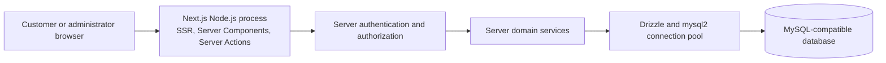

# Taqnia Store — Comprehensive Project Report

**Review date:** 2026-11-24  
**Repository scope:** Taqnia Store application and its project documentation  
**Production access or deployment:** None  
**Code or infrastructure changes made for this review:** None; this report is the only requested deliverable

## Executive summary

Taqnia Store has a sound technical foundation for a bilingual, server-rendered commerce application: a strict TypeScript Next.js App Router application, localized English/Arabic routes, a MySQL-compatible Drizzle data model, database-backed authentication and administration foundations, conservative connection pooling, and a documented cPanel deployment rehearsal.

The project is **not ready to launch as an operating online store**. The most important functional gap is that the public storefront does not read the database-backed catalog. Its products are static content and currently empty, while the admin product service writes to the database. Cart preservation, checkout, order creation, customer order history, and password-reset delivery are not implemented. Existing order administration can manage records that already exist, but there is no customer purchase flow that creates them.

Local hosting rehearsal evidence is strong but deliberately limited: fresh migrations, repeated migration execution, seed, and database smoke checks passed on disposable MariaDB 11.4.13 and 10.6.28 databases. Production builds and HTTP smoke checks passed in Node.js 22.23.5 and 24.22.3 containers. These results do **not** establish that the specific GoDaddy account offers either runtime, has adequate resources, routes the subdomain correctly, or permits the required database connectivity.

The database migration failure was traced to an overlong foreign-key identifier, not a proven network or pool failure. The identifier and a MariaDB 10.6 nullable-`TIMESTAMP` compatibility issue were corrected, then verified with fresh, repeated migrations. A production migration runner remains intentionally unavailable: the current Drizzle configuration restricts migrations to local development/test databases.

**Overall assessment:** strong scaffold and local compatibility evidence; incomplete commerce product; production deployment and launch remain blocked.

## 1. Scope, evidence, and limitations

This report reviews the present repository, current application source, tests, configuration, migration files, and project documentation. Findings distinguish between source implementation, local disposable-database evidence, documented plans, and account-specific facts that have not been verified.

- No application tests or builds were started as part of this report-only review. Test results below are the latest recorded local rehearsal results from 2026-11-24, not a new run performed for this report.
- No production database, GoDaddy account, WordPress database/site, or Odoo resource was accessed or changed.
- The repository checkout has no usable commit history for this review and the project files appear untracked. Consequently, this report cannot reconstruct change chronology or attribute individual changes to commits. It assesses the current files and recorded evidence.
- Local environment files were not inspected for values. Reports contain no credentials.
- This is a source and documentation review, not a penetration test, production load test, legal review, or account-level hosting certification.

## 2. Project scope and architecture

The repository contains one application, `apps/store/`, and project documentation. The Taqnia corporate website is a separate WordPress site and is explicitly outside this repository's scope.

### Technology stack

| Area                   | Current implementation                                                                     |
| ---------------------- | ------------------------------------------------------------------------------------------ |
| Web application        | Next.js 16.4.6 App Router; React and React DOM 19.3.0                                      |
| Language and runtime   | TypeScript 5.9.3; project engine requirement Node.js `>=22.0.0`                            |
| Database               | MySQL-compatible schema through Drizzle ORM 0.45.4, Drizzle Kit 0.31.11, and mysql2 3.24.6 |
| Validation and styling | Zod 4.6.7; Tailwind CSS 4.3.5                                                              |
| Tests                  | Vitest 5.1.1, Testing Library, Playwright 1.65.1, and Axe                                  |
| Quality tooling        | ESLint 9.39.5, Prettier 3.10.1, strict TypeScript                                          |
| Production mode        | Standard Node.js process using `next start`; standalone output is not enabled              |

The application uses locale-prefixed `/en` and `/ar` routes and server-rendered React components. Server Actions implement selected form submissions. Database access and domain services live under `src/server/`. The public UI copy and current sample content are centralized under `src/content/`.



There are no business Route Handlers at present, and no middleware or Proxy implementation was found. Admin product and order operations are server-rendered pages and Server Actions, not a public REST API. The API inventory and proposed quote endpoint are documented as planned, not implemented.

## 3. Feature and delivery status

“Implemented” below means that a route, UI, or service exists; it does not imply a complete customer purchase journey or production readiness.

| Area                        | Current status                                                                        | Material gap                                                                                                                                                                                |
| --------------------------- | ------------------------------------------------------------------------------------- | ------------------------------------------------------------------------------------------------------------------------------------------------------------------------------------------- |
| English/Arabic layout       | Implemented                                                                           | Bilingual layout and direction are present; content approval remains outstanding.                                                                                                           |
| Home and category discovery | UI implemented using centralized static content                                       | The public pages do not query the database catalog. They display an explicitly empty product state.                                                                                         |
| Search                      | Category matching is static; product results remain empty                             | The database catalog search service is not connected to the public search page.                                                                                                             |
| Product detail              | Route and component foundation exist                                                  | The static product content list is empty; database product-detail service is not wired to the reviewed storefront routes. Product URLs therefore do not expose admin-created catalog items. |
| Catalog administration      | Database-backed list/create/edit foundation exists                                    | Public catalog integration, product image management, full technical attributes, and end-to-end persistence coverage remain incomplete.                                                     |
| Authentication              | Registration, login, password hashing, and database sessions exist                    | Password reset delivery/redemption, account-detail editing, address management, abuse controls, and customer order history are not complete.                                                |
| Cart                        | Not implemented                                                                       | Guest cart and merge-on-login behavior are absent.                                                                                                                                          |
| Checkout and order creation | Not implemented                                                                       | There is no customer checkout path, order creation service, or authenticated-customer order flow.                                                                                           |
| Order administration        | Database-backed listing, detail, and update foundations exist                         | It can manage existing orders only; no storefront process currently creates them. Authenticated admin mutation flows lack the documented end-to-end integration coverage.                   |
| Manual payment/shipping     | Admin-side status and history support exists                                          | This is not a payment provider integration or a complete order workflow. Operational details and authorized staff remain owner-supplied.                                                    |
| Inventory                   | Tables and permissions exist                                                          | Inventory operations and customer-facing stock reservation/availability are not implemented.                                                                                                |
| Quote requests              | Public routes intentionally show unavailable state; admin prototype is synthetic/mock | No public submission, persistence, delivery, or conversion to an order is active. The prototype is not a production quote-management system.                                                |
| Legal and policy content    | Draft/placeholder status documented                                                   | Approved privacy, terms, returns, shipping, and any applicable cookie policy are launch blockers.                                                                                           |
| Notifications and support   | Not implemented as a production delivery workflow                                     | No approved notification configuration or tested email delivery path is present.                                                                                                            |
| Analytics                   | Disabled by default                                                                   | No external tracking is enabled, consistent with the version 1 scope.                                                                                                                       |

### Public catalog integration is the central functional gap

`src/content/products.ts` is an empty static catalog, and the reviewed home, search, category, and product routes use static content. Database catalog functions such as `listPublishedProducts`, `searchPublishedCatalog`, and `getPublishedProduct` exist in `src/server/services/catalog.ts`, but the reviewed public route files do not call them. The admin catalog is therefore separate from what customers can browse.

This gap is documented in the application README, but the roadmap also contains wording that can be read as if catalog services and migrations have not been exercised. The report separates the actual findings: database services and migrations have local compatibility evidence, while their connection to the public product experience is still missing.

### Quote prototype boundary

The admin quote interface uses static test fixtures and local component state. It does not persist data, send messages, accept public requests, or create orders. The public quote page is intentionally unavailable and `noindex`. This is a safe, explicit prototype boundary; it must not be presented as a functioning quote service.

## 4. Data model and migration reliability

The two Drizzle journal entries describe a 25-table schema. Major groups are:

- Identity and authorization: `users`, `customer_profiles`, `addresses`, `roles`, `permissions`, `user_roles`, `role_permissions`, `sessions`, and `password_reset_tokens`.
- Catalog and inventory: `categories`, `brands`, `products`, `product_categories`, `product_variants`, `product_images`, `attribute_definitions`, `product_attribute_values`, `inventory`, and `inventory_movements`.
- Orders and operations: `orders`, `order_items`, `order_payments`, `order_payment_history`, `order_shipping_history`, and `order_admin_notes`.

The model uses EGP integer minor units, relational constraints, indexes, bilingual product/category fields, order line snapshots, and separate payment and shipping histories. Local smoke verification reported 25 tables and 31 foreign keys. Migrations use the Drizzle MySQL journal and MySQL/MariaDB DDL.

### Migration failure: cause and resolution

The earlier migration incident was reported as a lost connection, but the underlying SQL error was MariaDB/MySQL `ERROR 1059`: a generated foreign-key identifier was 65 characters, exceeding the 64-character identifier limit. Drizzle Kit's terminal progress output obscured the actionable SQL error. The available evidence does not establish a Docker network failure or a connection-pool defect as the cause.

The failure was corrected by shortening the identifier. MariaDB DDL can commit statements independently, so the migration must not be assumed to have rolled back atomically when a later statement fails. The migration history table must reflect successful Drizzle execution; manually applying SQL alone is not proof that the journal and schema are synchronized.

MariaDB 10.6 testing also exposed a nullable `TIMESTAMP` default compatibility issue when `explicit_defaults_for_timestamp` is off. The schema/migration now declares nullable timestamp defaults explicitly. This behavior and the foreign-key length limit are addressed in the current baseline migration files.

### Repeatability evidence

The latest recorded test ran fresh migrations twice against separate disposable databases:

| Target          | Fresh migration | Second migration invocation                             | Seed and DB smoke |
| --------------- | --------------- | ------------------------------------------------------- | ----------------- |
| MariaDB 11.4.13 | Passed          | Passed; journal reported 2/2 with no pending migrations | Passed            |
| MariaDB 10.6.28 | Passed          | Passed; journal reported 2/2 with no pending migrations | Passed            |

The smoke test checks migration tracking, schema constraints, auth/session operations, catalog/detail queries, order lookup, transactions, row locks, timestamp defaults, and connection recovery. It uses synthetic data in disposable local databases. These results support a repeatable **local** migration workflow; they do not prove a production migration path.

### Production migration blocker

`drizzle.config.ts` intentionally restricts migration tooling to loopback development/test databases. That is a valuable safety guard, but it means production migrations are not currently executable by the documented command. A separately reviewed production migration procedure, backup/restore rehearsal, access controls, and explicit release approval are required before any schema change is deployed. Do not bypass the guard by manually editing `__drizzle_migrations`.

## 5. Database behavior and connection budget

The shared mysql2 pool is configured for a conservative default of three connections per Node.js process, with matching idle capacity, a 60-second idle timeout, a 10-second connection timeout, and a bounded waiting queue of 12. The configured connection limit can be overridden by environment. Application queries reuse the pool; transaction work is executed through the database transaction API, and the smoke run exercised row locks and recovery after connection failure.

An estimate of three simultaneously open database connections per application process is appropriate for the default configuration, not a statement of GoDaddy's connection allowance. Total possible sessions must also account for other application processes, maintenance scripts, monitoring, and administrative connections. The host's actual cap is unknown. A connection error should be surfaced to the affected operation; it should not be mistaken for successful work. Account-specific idle behavior and resource pressure still need testing.

The database-backed admin listings paginate at 50 records. The current public catalog service is not connected to the UI and should be reviewed for result limits and pagination before integration; the reviewed catalog queries do not establish a production-scale catalog performance bound. Search and catalog indexing should be load-tested against realistic, owner-approved data.

## 6. Node.js and cPanel compatibility

### Runtime and build evidence

The declared minimum is Node.js 22.0.0. The hosting rehearsal used Node.js 22.23.5 and 24.22.3 images. Both built the application, installed production dependencies, started the standard Next.js production server as a non-root user, queried the database, and returned HTTP 200 for `/en`, `/ar`, and `/ar/quote`.

`next start` uses `process.env.PORT`; the simulation assigns a port and binds the container port through a local host mapping. These tests demonstrate that Docker and root privileges are not required by the **application runtime**. They do not prove that the GoDaddy account's selector offers Node 22 or 24, or that cPanel's application manager assigns and proxies the port in the same way.

The application does not use Next.js standalone output. The deployment runbook's rehearsed package shape is `package.json`, `package-lock.json`, production `node_modules`, `.next/`, `public/`, and `next.config.ts`, with the app user's permissions allowing Next.js cache writes. Build in a controlled environment matching the production OS/Node runtime when cPanel build capacity is uncertain.

### Next.js feature compatibility matrix

| Feature                          | Current usage                                     | cPanel assessment                                                                                                                                              |
| -------------------------------- | ------------------------------------------------- | -------------------------------------------------------------------------------------------------------------------------------------------------------------- |
| App Router and Server Components | Core application rendering                        | Compatible with a standard persistent Node.js process, subject to Node version, memory, and CPU limits.                                                        |
| Server Actions                   | Auth, product admin, and order admin forms        | Compatible with Node hosting. Verify correct external HTTPS origin/proxy headers, request size/timeouts, and assigned-port behavior in the account.            |
| Route Handlers                   | No business Route Handlers found                  | No current runtime dependency. Proposed API documentation is not an implemented endpoint.                                                                      |
| Middleware/Proxy                 | None found                                        | No current edge-runtime dependency.                                                                                                                            |
| `next/image` optimization        | `images.unoptimized: true`                        | Does not require Next's image-optimization server path or native `sharp` for the current configuration. Product image source and content are still incomplete. |
| Static assets                    | `public/` and Next build output                   | Compatible when packaged and served by the Node app; verify file ownership and URL routing.                                                                    |
| Next cache / filesystem          | Standard `.next` runtime behavior                 | Requires writable, persistent-enough app cache paths and adequate disk quota. Verify permissions, cleanup, and restart behavior with cPanel.                   |
| Authentication sessions          | Database session records plus HTTP-only cookies   | Compatible with Node and HTTPS. Verify TLS/proxy configuration and production cookie behavior behind the actual host.                                          |
| Uploads                          | No production file-upload workflow found          | No present upload dependency. Future upload storage must not assume local disk persistence or unlimited quota.                                                 |
| Background workers               | None found                                        | No current worker or always-on queue requirement.                                                                                                              |
| External infrastructure          | MySQL-compatible database required for auth/admin | Requires verified host, grants, network access, database version, and connection limits.                                                                       |

The required production environment includes `NODE_ENV=production`, `PORT` as assigned by cPanel, `APP_BASE_URL`, `DATABASE_HOST`, `DATABASE_PORT`, `DATABASE_NAME`, `DATABASE_USER`, `DATABASE_PASSWORD`, `DATABASE_CONNECTION_LIMIT`, and a high-entropy `SESSION_SECRET` of at least 32 characters. `ANALYTICS_ENABLED` remains false. Secret values belong in the host's server-side environment configuration, not the package.

### Account-specific blockers

The following are not established by local simulation:

- GoDaddy plan name and the Node.js version actually available to this account.
- Application Manager startup command, root directory, port assignment, restart policy, and proxy behavior.
- Binding `store.taqnia-eg.net` without changing the WordPress document root.
- SSL/TLS termination, forwarded host/protocol headers, and action-origin behavior.
- Node CPU, RAM, process, disk, inode, and writable-cache limits.
- MySQL host/version, grants, network connectivity, storage, and connection cap.
- Backup/restore facilities, retention, and whether the app can be restarted safely after a release.
- Native image tooling; the current unoptimized setting avoids relying on it.

## 7. Authentication, authorization, and security posture

The current implementation uses Node.js `scrypt` password hashing, random opaque session tokens stored as HMAC-SHA256 fingerprints, and database-backed session validation. Cookies are HTTP-only, `SameSite=Lax`, path-scoped, and marked Secure in production. Login errors are generic. Zod validates external input, and database access uses parameterized Drizzle operations.

Admin pages/actions check permissions on the server. Product operations use `catalog.manage`; order operations distinguish `orders.manage`, `shipping.manage`, and `payments.verify`. Payment status handling requires verification notes for transfer payments marked paid and restricts COD paid status until delivery. Shipping/payment transitions are recorded in history, with transaction and row-lock behavior exercised in the database smoke test.

### Gaps to close before public launch

1. **Authentication abuse controls:** Login and registration rate limiting are documented launch blockers and were not found in the application source. Add an approved rate-limit mechanism that fits the hosting environment and does not assume a distributed cache that does not exist.
2. **Security headers:** `next.config.ts` disables the powered-by header and configures unoptimized images, but no explicit CSP, HSTS, frame protection, `X-Content-Type-Options`, `Referrer-Policy`, or `Permissions-Policy` configuration was found. Decide which headers are emitted by the app or trusted proxy and verify them over production HTTPS.
3. **Password recovery:** The schema includes password-reset token support, but reset issuance, delivery, redemption, and associated abuse controls are not implemented.
4. **Customer access flows:** Customer address management, order ownership views, and customer order history are not implemented, so their authorization boundaries have not been exercised end to end.
5. **Session operations:** Establish and test policies for session expiry/revocation, account recovery, and administrative credential provisioning before creating a production administrator.
6. **Operational logging and privacy:** Confirm that cPanel/proxy logs, diagnostics, and backups do not expose credentials, tokens, or unnecessary order/customer data. Define personal-data retention and restore access.

No confirmed exploitable vulnerability was established in this source review. The items above are gaps against the documented security requirements and are not a substitute for an independent security assessment. No penetration test was performed.

## 8. SEO, accessibility, and performance

### SEO and content

Localized metadata, language/direction attributes, canonical and `hreflang` handling for relevant pages, and `noindex` behavior for search/unavailable quote pages have test coverage. The application defines a metadata base and localized page titles.

The documented SEO requirements are not yet complete: no sitemap or `robots` route was found, and product/organization/breadcrumb structured data is not present in the reviewed app routes. Product metadata must not be generated from unverified values. Public catalog integration and approved catalog content are prerequisites for useful product indexing.

### Accessibility and responsive behavior

The latest recorded Playwright run checks the home page in English and Arabic at four viewport widths (360, 768, 1024, and 1440 pixels) with Axe, failing on serious or critical WCAG 2.2 A/AA violations. E2E also checks mobile widths as small as 320 pixels, keyboard-operable mobile navigation, route language/direction, empty states, and search/category interactions.

This is useful automated coverage, not a complete WCAG conformance claim. Manual keyboard, screen-reader, zoom, form-error, and admin workflow review remains necessary, especially after database catalog and checkout journeys are implemented.

### Performance

The design favors Server Components and disables image optimization to avoid an unverified native dependency. Admin results are paginated and the database pool is conservative. No Lighthouse, field Core Web Vitals, realistic catalog load test, or cPanel resource benchmark was recorded. The performance budget's Lighthouse and LCP/CLS/INP goals therefore remain targets, not measured outcomes. Before catalog launch, implement bounded public queries, pagination or an approved result cap, suitable indexes, and caching that does not risk stale prices or authorization leakage.

## 9. Testing and verification record

The following are the latest recorded results available for this review, dated 2026-11-24. They were not rerun while creating this report.

| Check                                         | Latest recorded outcome                                               | Coverage limit                                                                                                                                                                       |
| --------------------------------------------- | --------------------------------------------------------------------- | ------------------------------------------------------------------------------------------------------------------------------------------------------------------------------------ |
| `npm run db:migrate` twice on MariaDB 11.4.13 | Passed; second execution reported no pending migrations               | Fresh disposable local database only                                                                                                                                                 |
| `npm run db:migrate` twice on MariaDB 10.6.28 | Passed; second execution reported no pending migrations               | Separate fresh disposable local database only                                                                                                                                        |
| `npm run db:seed` on each target              | Passed                                                                | Seeds roles, permissions, and category labels, not products or an admin user                                                                                                         |
| `npm run db:hosting-smoke` on each target     | Passed                                                                | Auth/session, catalog/detail query, order lookup, constraints, transactions/locks, timestamp defaults, migration tracking, and connection recovery; not full admin browser workflows |
| `npm run lint`                                | Passed                                                                | Recorded local run                                                                                                                                                                   |
| `npm run typecheck`                           | Passed                                                                | Recorded local run                                                                                                                                                                   |
| `npm test`                                    | Passed: 23 tests                                                      | Unit/component tests; not a full database-backed admin suite                                                                                                                         |
| `npm run test:e2e`                            | Passed: 15 tests                                                      | Public empty-catalog experience, localization, protected-route redirects, quote unavailable state, and responsive/accessibility checks; no complete checkout journey                 |
| Production build                              | Passed on Node.js 22.23.5 and 24.22.3                                 | Container rehearsal, not GoDaddy                                                                                                                                                     |
| Production startup and HTTP smoke             | Passed on both Node images; HTTP 200 on `/en`, `/ar`, and `/ar/quote` | Local simulation, not public DNS or cPanel                                                                                                                                           |
| CI dependency audit                           | Configured in `.github/workflows/ci.yml`                              | No current CI run result was available in this review                                                                                                                                |
| Coverage thresholds                           | 80% thresholds configured for service coverage                        | The recorded `npm test` command did not report a coverage run; thresholds are not evidence of achieved coverage                                                                      |
| GoDaddy account validation                    | Not performed                                                         | Requires account owner/operator access and approval                                                                                                                                  |

The CI workflow runs standard dependency installation, migration-history check, audit, lint, typecheck, unit/component tests, build, and E2E. The MariaDB hosting smoke is a manual local rehearsal and is not currently a CI service. Admin page access is tested for unauthenticated redirects, but authenticated browser-driven product mutations, order mutations, customer-owned order access, checkout, and cart merge are not covered.

## 10. Deployment package and release procedure

The smallest rehearsed cPanel package contains:

- `package.json` and `package-lock.json`
- Production dependencies installed for the target Linux/Node runtime (`npm ci --omit=dev`)
- `.next/` production build output
- `public/`
- `next.config.ts`

Use the application root assigned to the cPanel Node application, not the WordPress document root. Start with `npm start`, let cPanel supply `PORT`, and ensure the runtime user can write the required Next cache directory. Build artifacts in a compatible controlled environment if shared-host build resources are unknown. Do not upload `.env*`, local database files, test output, or credentials.

Recommended release sequence:

1. Verify account-specific runtime, app root, subdomain mapping, port behavior, SSL, database access, quotas, and backups.
2. Review and test the release artifact on a matching Node/Linux runtime.
3. Take a verified, restorable database backup before schema changes.
4. Use only a separately approved production migration procedure; current guarded Drizzle configuration is local-only.
5. Upload to the store's independent application root and set server-side environment variables.
6. Start/restart the Node app and verify locale routes, database access, authentication, logs, HTTPS headers, and the corporate WordPress site remains unchanged.
7. Roll back application files independently where safe. Restore a database only after confirming schema compatibility and data-loss implications.

The runbook accurately warns that current hosting rehearsal does not certify the GoDaddy account. Also note that a rollback to older application files may not be safe after schema changes; migration/rollback plans must be release-specific.

## 11. Documentation and governance observations

The project has substantial architecture, security, testing, SEO, deployment, backup, environment, and decision documentation. The ADRs record the store/corporate separation, dynamic Next.js direction, MySQL/Drizzle choice, and manual payment/shipping model. Quote persistence and delivery are correctly treated as gated decisions.

One status inconsistency should be resolved in the normal documentation workflow: `docs/00-overview/roadmap.md` says neither migration has been applied to MySQL, while the updated deployment runbook records successful fresh disposable MariaDB 11.4 and 10.6 rehearsals. These statements can be reconciled by explicitly distinguishing **local test databases** from **production/GoDaddy databases**. The same distinction should be kept in every status document.

Current repository governance also cannot provide commit-level review evidence because the checkout has no usable commit history. Before normal release work, restore the intended private-repository branch/commit context and review untracked changes carefully; do not infer that the present working tree is a clean baseline.

## 12. Prioritized recommendations

### P0 — Required before a real commerce launch

1. Connect the public home/category/search/product routes to the database catalog service, with bounded result sizes, pagination, and verified product data.
2. Implement guest cart persistence and merge-on-login, then authenticated checkout and transactional order creation. Preserve price/quantity snapshots and customer ownership.
3. Implement and test customer order history and address management with strict server-side ownership checks.
4. Obtain owner-approved catalog, payment instructions, admin roster, operational contacts, and legally approved policies. Keep sample data visibly synthetic.
5. Approve a production migration process that is separate from the local-only Drizzle guard; rehearse backup, migration, partial-failure inspection, and rollback on a non-production environment.
6. Verify all GoDaddy account-specific prerequisites and the production host's runtime and database limits before any upload.

### P1 — Required before broad public exposure

1. Add rate limiting for registration and login, and apply it to future reset/checkout paths.
2. Add/verify security headers and TLS/proxy behavior; test real response headers behind the actual cPanel routing.
3. Complete password reset and production administrator provisioning with audited access controls.
4. Add database-backed integration and authenticated E2E tests for product writes, order updates, permissions, customer ownership, and error handling.
5. Define customer-data retention, backup access, restore frequency, monitoring, and incident procedures.
6. Exercise pool and query behavior within the confirmed account connection/CPU/memory budget.

### P2 — Operational quality and discoverability

1. Add sitemap and robots rules, and only add structured data from approved, verified catalog records.
2. Measure Lighthouse/Core Web Vitals and perform a representative catalog/load test.
3. Review catalog search query plans, indexes, caps, pagination, and cache invalidation before real inventory grows.
4. Complete manual accessibility review for admin/account forms and future cart/checkout flows.
5. Align roadmap and launch checklist wording with the latest local compatibility evidence and explicit production blockers.

## 13. Exact local verification commands

Run database commands only against a verified disposable local database. The committed examples use local placeholders and must not be repurposed as production credentials.

```bash
cd apps/store
npm ci
npm run lint
npm run typecheck
npm test
npm run build
npm run test:e2e
```

For the documented MariaDB 11.4 hosting simulation:

```bash
cd apps/store
cp .env.hosting-simulation.example .env.local
npm run hosting:simulation:up
npm run db:migrate
npm run db:migrate
npm run db:seed
npm run db:hosting-smoke
npm run hosting:simulation:app
curl -I http://127.0.0.1:3310/en
curl -I http://127.0.0.1:3310/ar
npm run hosting:simulation:status
npm run hosting:simulation:down
```

For the separate MariaDB 10.6 target, start its separate compatibility Compose project, then run migrations twice, seed, and smoke using `DATABASE_PORT=3308`; use the matching `hosting:compat:106:up` and `hosting:compat:106:down` commands documented in `apps/store/README.md`. Do not remove or overwrite any pre-existing simulation resources. The disposable rehearsal must remain isolated from WordPress, Odoo, and production.

## 14. Source and documentation references

- Project scope and milestones: [project brief](../00-overview/project-brief.md), [roadmap](../00-overview/roadmap.md), [assumptions](../00-overview/assumptions.md)
- Architecture and hosting: [system overview](../architecture/system-overview.md), [data model](../architecture/data-model.md), [hosting and deployment](../architecture/hosting-and-deployment.md)
- Operations: [deployment runbook](../operations/deployment-runbook.md), [backup and restore](../operations/backup-and-restore.md), [environment variables](../operations/environment-variables.md)
- Quality and risk: [security](../engineering/security.md), [testing strategy](../engineering/testing-strategy.md), [performance budget](../engineering/performance-budget.md), [SEO](../engineering/seo.md)
- Application setup: [store README](../../apps/store/README.md), [package manifest](../../apps/store/package.json), [Next.js configuration](../../apps/store/next.config.ts)
- Database: [Drizzle configuration](../../apps/store/drizzle.config.ts), [database connection](../../apps/store/src/server/db/connection.ts), [schema](../../apps/store/src/server/db/schema.ts), [migration journal](../../apps/store/drizzle/meta/_journal.json)
- Public and admin catalog: [public catalog service](../../apps/store/src/server/services/catalog.ts), [admin catalog service](../../apps/store/src/server/services/admin/catalog.ts), [static product content](../../apps/store/src/content/products.ts)
- Commerce operations: [admin order service](../../apps/store/src/server/services/admin/orders.ts), [order actions](../../apps/store/src/server/admin/order-actions.ts), [quote prototype](../../apps/store/src/components/features/admin/quote-dashboard.tsx)
- Automated checks: [CI workflow](../../.github/workflows/ci.yml), [Playwright configuration](../../apps/store/playwright.config.ts), [Vitest configuration](../../apps/store/vitest.config.ts)

## Final conclusion

The current project is a well-documented and locally rehearsed Next.js/Drizzle foundation with meaningful authentication, admin, migration, and bilingual UI work. Migration execution is repeatable against the tested disposable MariaDB versions, and the standard Node.js production process works in tested containers.

It is not yet a complete ecommerce system: the public catalog is disconnected from database-managed products, and there is no cart, checkout, or order-creation flow. Production migrations, GoDaddy account compatibility, legal approval, and owner-supplied catalog/payment/operations data are unresolved. Keep deployment blocked until the P0 requirements and account-level checks are completed and independently verified.
